[](https://sewaproyektortgr.com)
[](https://instagram.com/sewaproyektor.tgr)
[](https://tiktok.com/@sewaproyektor.tgr)
[](https://nextjs.org)
[](https://react.dev)
[](https://www.typescriptlang.org)
[](https://tailwindcss.com)
[](https://supabase.com)
[](https://swiperjs.com)

<div align=center>
    
    <h3>@sewaproyektor.tgr Website Portfolio</h3>
</div>

### Overview
<p align=justify>
    <code>SEWAPROYEKTOR.TGR</code> is a marketing and product catalog website for projector rental services in Tangerang. The site presents company information, a live product catalog, and an admin workflow for managing product listings stored in Supabase.
</p>

### Website Scope

- Public pages: home, products, and about.
- Product catalog data is loaded from Supabase.
- Each product is expected to use its own `image_url` from the database.
- Admin access supports authenticated product management.
- WhatsApp is used as the primary contact and conversion channel.

### Environment Variables

The project expects the following environment variables:

```bash
NEXT_PUBLIC_SUPABASE_URL=https://your-project-ref.supabase.co # Supabase project URL
NEXT_PUBLIC_SUPABASE_ANON_KEY=your-supabase-anon-key # Supabase anonymous key
NEXT_PUBLIC_GOOGLE_TAG_ID=your-google-tag-id # Google Ads conversion tracking ID
NEXT_PUBLIC_GOOGLE_TAG_MANAGER_ID=your-google-tag-manager-id # Google Tag Manager ID
NEXT_PUBLIC_PHONE_NUMBER=628XXXXXXXXXX # Business phone number
SERVER_ACTIONS_ALLOWED_ORIGINS= # Allowed origins for server actions (comma-separated)

```

### Product Data Notes

- Product images are not sourced from `SITE_IMAGES`.
- `SITE_IMAGES` is reserved for the static home and about page assets.
- Catalog product cards rely on the `image_url` field returned from the database.
- If a product is missing `image_url`, the UI shows a fallback text state instead of using a site-wide placeholder image.

### Local Development Notes

- Use `npm.cmd run dev` in PowerShell if `npm` is blocked by local execution policy.
- Use `npm.cmd run build` to verify the production build locally before deploying.
- The duplicate `sewaproyektor.tgr` folder is excluded from TypeScript checks through `tsconfig.json` and is not part of the active app build.

### Deployment Notes

- The project is intended to be deployed on Vercel.
- Confirm all required public environment variables are configured in the Vercel project before running a production deployment.
- A successful local build is the closest validation for the Vercel build pipeline used by this repository.

This is a [Next.js](https://nextjs.org) project bootstrapped with [`create-next-app`](https://nextjs.org/docs/app/api-reference/cli/create-next-app).

### Getting Started

First, run the development server:

```bash
npm run dev
# or
yarn dev
# or
pnpm dev
# or
bun dev
```

Open [http://localhost:3000](http://localhost:3000) with your browser to see the result.

You can start editing the page by modifying `app/page.tsx`. The page auto-updates as you edit the file.

This project uses [`next/font`](https://nextjs.org/docs/app/building-your-application/optimizing/fonts) to automatically optimize and load [Geist](https://vercel.com/font), a new font family for Vercel.

### Learn More

To learn more about Next.js, take a look at the following resources:

- [Next.js Documentation](https://nextjs.org/docs) - learn about Next.js features and API.
- [Learn Next.js](https://nextjs.org/learn) - an interactive Next.js tutorial.

You can check out [the Next.js GitHub repository](https://github.com/vercel/next.js) - your feedback and contributions are welcome!

### Deploy on Vercel

The easiest way to deploy your Next.js app is to use the [Vercel Platform](https://vercel.com/new?utm_medium=default-template&filter=next.js&utm_source=create-next-app&utm_campaign=create-next-app-readme) from the creators of Next.js.

Check out our [Next.js deployment documentation](https://nextjs.org/docs/app/building-your-application/deploying) for more details.
